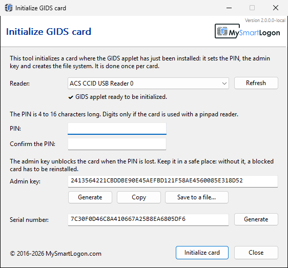

# GIDS Initialization Tool

Initializes a smart card where the [GIDS applet](https://github.com/vletoux/GidsApplet) has just been installed: it sets the user PIN, the admin key and creates the file system expected by the Windows GIDS minidriver. After that the card is used with no driver installation on Windows (read **and** write: enrollment, PFX import, PIN change) and through OpenSC on Linux and macOS.



## Download

`InitializeGids.exe` for x86, x64 and ARM64 is in the [releases](https://github.com/vletoux/GidsInitializationTool/releases). It is a single native executable (about 70 KB), with no installation.

## Usage

1. Install the applet on a Java Card, for example with [GlobalPlatformPro](https://github.com/martinpaljak/GlobalPlatformPro): `gp --install GidsApplet.cap`
2. Run `InitializeGids.exe`. The reader whose card waits for its initialization is selected.
3. Choose the PIN, keep the admin key (Copy or Save to a file), click **Initialize card**.

The admin key is the only way to unblock the PIN (challenge/response of the Windows PIN unblock dialog, or `gids-tool --unblock`). A random one is proposed; a card initialized with a lost admin key and a blocked PIN has to be reinstalled.

### Command line

```
InitializeGids.exe --pin <pin> [--admin-key <48 hex>] [--serial <32 hex>] [--reader <name>]
```

Without `--admin-key`, a random key is generated and printed. The exit code is 0 on success. The program is a Windows application: pipe its output (`| more`) so that cmd or PowerShell waits for it.

On Linux and macOS, the same initialization is done by OpenSC:

```
gids-tool --initialize --pin 123456 --admin-key 000000000000000000000000000000000000000000000000
```

## What it writes

The sequence is the one of `gids-tool --initialize` (OpenSC `card-gids.c`):

| Step | APDU |
|---|---|
| user PIN (reference 80) | `00 24 01 80` |
| BER-TLV EFs A000, A010-A014 with their ACL | `00 E0 00 00` + `00 44 00 00` |
| admin key file B080 and the 3DES key | `00 E0 00 00`, `00 DB 3F FF` (tag 70) |
| master file, cardapps, cardcf, cmapfile, cardid | `00 DB` |
| activation: the ACL are enforced from now on | `00 A4 00 0C 3FFF` + `00 44 00 00` |

A card is considered initialized when its master file (`A000` / `DF1F`) can be read; the tool never initializes a card twice.

## Building

Open `GidsInitializationTool.sln` with Visual Studio 2017 or later (the project uses the default toolset of the Visual Studio that opens it), or:

```
msbuild GidsInitializationTool.sln /p:Configuration=Release /p:Platform=x64
```

The version comes from the last `v*` tag (`GenerateVersion.ps1`).

## License

MIT, see [LICENSE](LICENSE).
